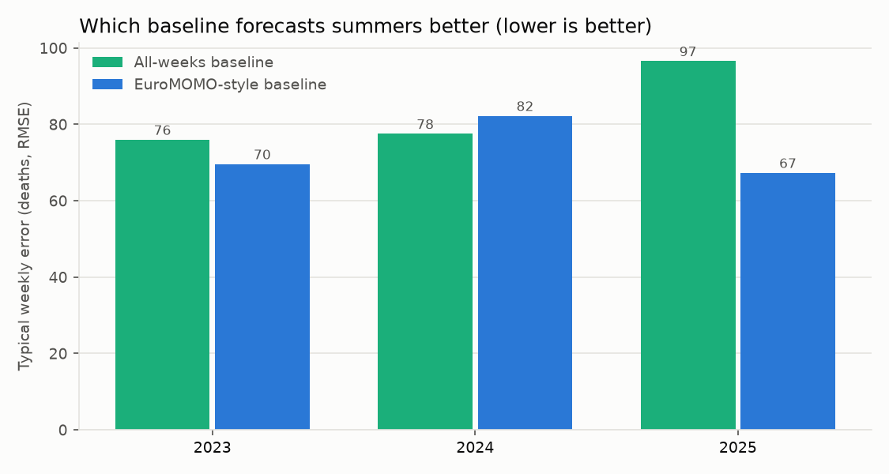
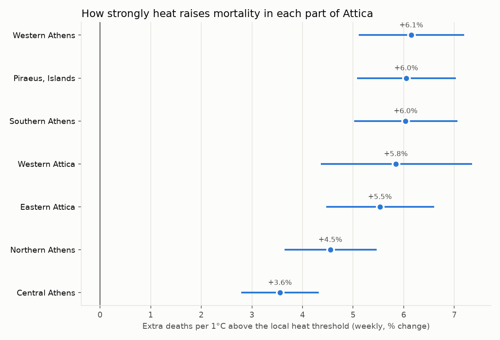
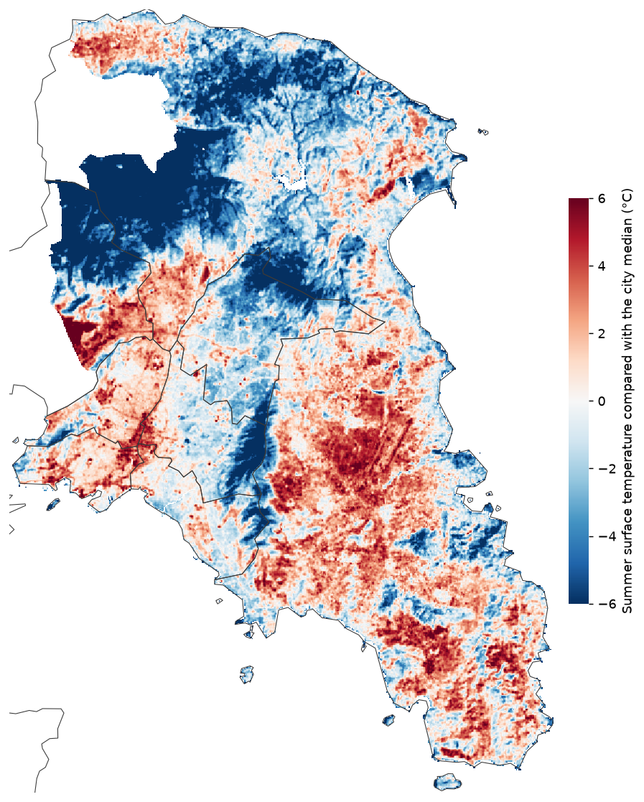
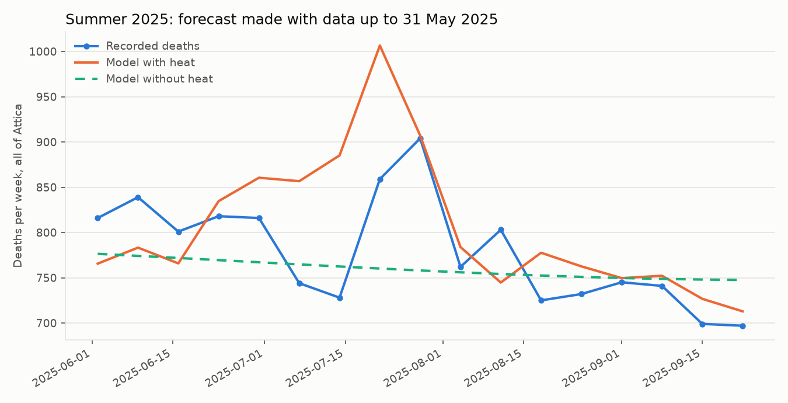
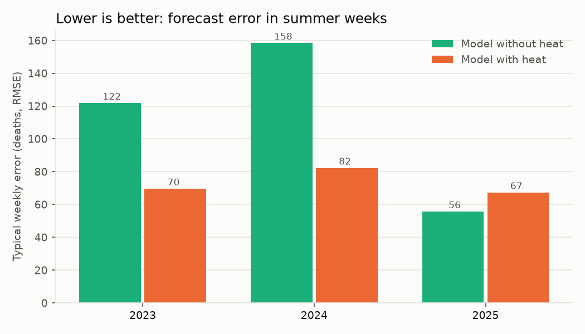

# BUARO results: Attica, step 2

Run date: 2026-11-14. Data up to week 2026-W27. Deaths dataset: `demo_r_mwk3_t`.

## What this step answers

How much does heat raise the number of deaths in each part of Attica, can a model that knows this forecast a summer better than a model that ignores heat, and is Attica becoming less vulnerable over time?

## Two ways to set the normal level of deaths

Heat deaths are measured against a normal level of deaths. The pipeline tests two ways to set it, and keeps the one that forecasts unseen summers better:

- **All-weeks baseline**: learns the normal level from every week of the year, with a long-term trend.
- **EuroMOMO-style baseline**: learns the normal level only from calm weeks in spring (weeks 16 to 25) and autumn (weeks 37 to 44), with a separate level for each year, as the European mortality monitoring network EuroMOMO does. A hard winter or a hot summer cannot distort it.

| Baseline | Summers tested | Mean weekly error with heat | Summers where heat improved the forecast |
|---|---|---|---|
| EuroMOMO-style baseline | 3 | 73.1 | 2 of 3 |
| All-weeks baseline | 3 | 83.4 | 2 of 3 |

Selected: **EuroMOMO-style baseline** (rule fixed in advance: lowest mean weekly error over all tested summers).

## How vulnerable each area is

The heat threshold was learned from the data: weeks hotter than the 80th percentile of each area's weekly maximum temperature.
Across Attica, each extra 1°C above that threshold raises weekly deaths by about 5.4% (95% range 4.4% to 6.4%).
Differences between areas beyond chance (I²): 83%.
Verdict: the data show a clear heat effect on mortality.

| Area | Extra deaths per +1°C | 95% range | Share aged 65+ | Threshold (°C) |
|---|---|---|---|---|
| Western Athens | 6.1% | 5.1% to 7.2% | 20.8% | 31.5 |
| Piraeus, Islands | 6.0% | 5.1% to 7.0% | 22.4% | 31.3 |
| Southern Athens | 6.0% | 5.0% to 7.1% | 23.7% | 31.5 |
| Western Attica | 5.8% | 4.4% to 7.3% | 17.8% | 31.3 |
| Eastern Attica | 5.5% | 4.5% to 6.6% | 20.5% | 31.0 |
| Northern Athens | 4.5% | 3.6% to 5.5% | 24.2% | 30.6 |
| Central Athens | 3.6% | 2.8% to 4.3% | 22.7% | 31.1 |

## What explains the differences between areas

Each area's heat effect is compared with one feature of the places where its residents live, measured on the Eurostat 1 km census grid and the Copernicus Urban Atlas 2021 and Street Tree Layer 2021.
The test is a random-effects meta-regression across the seven areas, one feature at a time. It shows associations between areas, not proof of cause.

Because 5 features are tested, the p value is also shown after the Holm correction for multiple tests.

| Feature | Range across areas | Change in extra deaths per +1°C, per 1 SD | 95% range | p | p after Holm correction | Share of area differences explained | Verdict |
|---|---|---|---|---|---|---|---|
| Street tree cover where people live | 0.8% to 8.1% | -0.93 pp | -1.87 to +0.01 | 0.052 | 0.206 | 65% | no clear link |
| Green urban areas where people live | 1.2% to 9.3% | -1.10 pp | -1.60 to -0.60 | 0.002 | 0.012 | 100% | lower heat risk where higher |
| Dense, highly sealed urban fabric where people live | 28.4% to 64.0% | +0.14 pp | -1.31 to +1.59 | 0.818 | 1.000 | 0% | no clear link |
| Built-up land where people live | 73.2% to 97.9% | -0.35 pp | -1.74 to +1.04 | 0.548 | 1.000 | 0% | no clear link |
| Share of residents aged 65+ (census 2021) | 16.8% to 22.7% | -0.56 pp | -1.91 to +0.79 | 0.333 | 0.998 | 12% | no clear link |

Check: the Urban Atlas covers less than 80% of the residents of Western Attica, so each land feature is tested again without it.

| Feature | Change per 1 SD, without the low-coverage area | 95% range | p | Verdict |
|---|---|---|---|---|
| Street tree cover where people live | -0.94 pp | -2.04 to +0.15 | 0.076 | no clear link |
| Green urban areas where people live | -1.13 pp | -1.69 to -0.56 | 0.005 | lower heat risk where higher |
| Dense, highly sealed urban fabric where people live | +0.17 pp | -1.60 to +1.94 | 0.801 | no clear link |
| Built-up land where people live | -0.26 pp | -1.96 to +1.43 | 0.687 | no clear link |

Verdict: green urban areas where people live is clearly linked to the differences in heat risk between areas.
The link holds after the Holm correction for testing several features. It remains an association between seven areas; step 3 tests the cooling itself at 100 m.

## What cools the city: surface temperature at 100 m

Every clear Landsat 8 and 9 scene of June to August since 2014 (246 scenes) gives the land surface temperature of each 100 m cell in late morning. Each scene is compared with the median of the built-up city that day, so hot and cool days cancel out.
Only built-up cells are used (at least 50% built-up land, 62,700 cells), where the Street Tree Layer is mapped. Each cell is compared only with the other cells of the same 1 km square, so the sea, the hills and the wind cannot pose as cooling.
The model learns from the summers 2014 to 2022 and is then tested on 2023, 2024, 2025, 2026, which it has never seen.

| Feature | Change | Summers it learned from | Unseen summers |
|---|---|---|---|
| Street tree cover | +10 percentage points | -0.27°C (-0.30 to -0.23) | -0.23°C (-0.27 to -0.20) |
| Green urban areas | +10 percentage points | +0.02°C (-0.02 to +0.07) | +0.05°C (+0.00 to +0.10) |
| Dense, highly sealed urban fabric | +10 percentage points | -0.10°C (-0.13 to -0.07) | -0.11°C (-0.14 to -0.08) |
| Built-up land | +10 percentage points | -0.06°C (-0.08 to -0.03) | -0.08°C (-0.11 to -0.06) |
| Elevation | +100 m | -0.54°C (-0.79 to -0.29) | -0.45°C (-0.71 to -0.19) |

Surface temperature by street tree cover, compared with cells with almost no trees (0-2%), same 1 km square:

| Tree cover | Difference | 95% range | Cells |
|---|---|---|---|
| 0-2% | +0.00°C | +0.00 to +0.00 | 36,610 |
| 2-5% | -0.23°C | -0.28 to -0.19 | 4,109 |
| 5-10% | -0.31°C | -0.36 to -0.25 | 6,620 |
| 10-20% | -0.52°C | -0.60 to -0.45 | 6,592 |
| 20-30% | -0.81°C | -0.92 to -0.69 | 3,478 |
| 30-40% | -1.00°C | -1.16 to -0.83 | 2,039 |
| 40-100% | -1.41°C | -1.61 to -1.22 | 3,252 |

| Unseen summer | Cooling per +10 points of tree cover | 95% range |
|---|---|---|
| 2023 | -0.24°C | -0.28 to -0.21 |
| 2024 | -0.23°C | -0.27 to -0.20 |
| 2025 | -0.22°C | -0.25 to -0.19 |
| 2026 | -0.24°C | -0.27 to -0.21 |

Verdict: street trees cool the city surface. Each +10 percentage points of tree cover lowers late-morning surface temperature by about 0.27°C, and the unseen summers confirm it (-0.23°C), every one of them on its own. Cells with more than 40% tree cover are about 1.4°C cooler than cells with almost none.
Green urban areas add no cooling of their own once their trees are counted, most likely because open, dry grass in an Athens summer heats up much like bare ground. The link between green areas and lower heat mortality found between areas is therefore most likely carried by their trees, and by the shade and cooler air they offer to people, which surface temperature does not measure.
Dense, highly sealed fabric is slightly cooler at the surface in late morning than open, low-density or industrial land in the same square, most likely because tall buildings shade the streets while bare land and large flat roofs heat fastest. This is a daytime surface effect; dense fabric releases its heat at night, which Landsat does not see.

The features explain 9% of the differences between cells of the same square in the unseen summers. The rest comes from roofs, materials and street shape, which no open European layer maps yet. The finding is the size of the tree effect and its stability from summer to summer, not a full map of the causes.

## Heat deaths at 1.5°C, 2°C and 3°C of global warming

The summers 2015 to 2025, outside the pandemic years, are replayed at the three reference levels of the EU Climate Resilience Law. Each week's maximum temperature is raised by the summer warming that the CMIP6 models of the Copernicus Interactive Climate Atlas project for Athens at that level, month by month, relative to 2011-2030. Population and vulnerability stay as they are today, so the numbers show what warming alone would do if nothing else changed.

| Global warming | Summer warming in Athens | Heat-related deaths per summer | Range | Compared with today | Weeks above the threshold, per area |
|---|---|---|---|---|---|
| Today | +0.0°C | 963 | 775 to 1,158 | 1.00× | 11.0 |
| 1.5°C | +0.4°C | 1,143 | 729 to 1,698 | 1.19× | 11.6 |
| 2°C | +0.9°C | 1,426 | 953 to 2,345 | 1.48× | 12.8 |
| 3°C | +2.3°C | 2,204 | 1,427 to 3,315 | 2.29× | 14.2 |

Verdict: at 3°C of global warming, the same summers would bring about 2.3 times today's heat deaths in Attica, unless vulnerability falls. Step 4 measures how much of that street trees and green areas can prevent.

## What prevents heat deaths: measures

Two independent lines of evidence are set side by side, because they answer different questions.

- **Cooling measured from space** (step 3): more street trees where people live lower the surface temperature. Only part of that reaches the air people breathe: across 392 European urban areas, trees cool the daytime air about 12 times less than the surface (Du et al. 2024, Environmental Research Letters). The low end uses that ratio, the high end assumes the air cools as much as the surface.
- **Difference between areas** (step 2): areas with more green and more trees lose fewer people per degree of heat. Bringing each area up to the best-covered area of Attica stays inside what Attica already shows; it includes everything that comes with greener neighbourhoods, so it is an upper bound.

| Measure | Evidence | Heat deaths avoided per summer, today's climate | Range | Share of heat deaths | New cover needed |
|---|---|---|---|---|---|
| Street trees +10 points | cooling measured from space | 9 | 8 to 111 | 1.0% | 6,080 ha |
| Street trees +5 points | cooling measured from space | 5 | 4 to 57 | 0.5% | 3,040 ha |
| Green urban areas up to the best area of Attica | difference between areas | 301 | 167 to 431 | 31.3% | 3,395 ha |
| Street trees up to the best area of Attica | difference between areas | 234 | -2 to 458 | 24.3% | 1,578 ha |

Verdict: the cooling that trees bring to the air explains only a small part of the protection seen in greener areas (9 deaths a summer for “Street trees +10 points”, against 301 for “Green urban areas up to the best area of Attica”). Greener neighbourhoods most likely protect people in other ways as well, such as shade where people walk and wait, cooler homes, and the housing and health that often come with them; with seven areas these cannot yet be told apart. Trees are worth planting for cooling, but most of the gain seen between areas lies in what makes green neighbourhoods safer.

## Is Attica adapting?

The model lets the heat effect change linearly from year to year. A negative trend means each degree of heat is becoming less deadly.
Estimated extra deaths per +1°C: 6.5% in 2015 and 4.8% in 2025.
Yearly change in the log relative risk: -0.0016 (95% range -0.0026 to -0.0007).
Verdict: not robust. The trend points to heat becoming less deadly per degree, but it disappears when the summer of 2025 is left out. One unusual summer is not evidence of adaptation, so no claim is made yet.

A check that needs no model: how many extra summer deaths each degree of heat brought, year by year.

| Summer | Extra deaths, weeks 26 to 36 | Degree-weeks above threshold | Extra deaths per degree-week |
|---|---|---|---|
| 2015 | 523 | 19.7 | 26.6 |
| 2016 | 430 | 15.8 | 27.2 |
| 2017 | 817 | 24.1 | 33.9 |
| 2018 | 407 | 9.7 | 42.1 |
| 2019 | 113 | 15.5 | 7.3 |
| 2023 | 1,086 | 29.6 | 36.6 |
| 2024 | 1,323 | 32.5 | 40.7 |
| 2025 | 327 | 27.5 | 11.9 |

## The test: forecasting summers the model has never seen

For each summer, the model is trained only on data available up to 31 May of that year, then asked to predict June to September.
A skill score above 0 means that knowing about heat made the forecast better.

| Summer | Recorded deaths | Forecast with heat | Forecast without heat | Heat-attributable deaths | Skill score |
|---|---|---|---|---|---|
| 2023 | 14,232 | 14,481 | 13,378 | 1,724 | 0.67 |
| 2024 | 14,712 | 14,213 | 12,687 | 2,106 | 0.73 |
| 2025 | 13,229 | 13,676 | 12,912 | 1,362 | -0.46 |

Knowing about heat improved the forecast in 2 of 3 summers tested.

## Cross-check against published research

ISGlobal (Janoš et al. 2025, Nature Medicine), Greece, summer 2024: 5,980 heat-related deaths in Greece. Scaled to Attica's population share, that is about 2,176.
This model estimates 2,106 for Attica in summer 2024.
Order-of-magnitude cross-check only. ISGlobal uses daily data and a different model; weekly data are known to underestimate heat mortality by 5% to 20%.

## Data

Every weekly number used by the model is in `data_panel.xlsx`, so anyone can check the results.

## Honest limits

- Deaths are weekly and by area (NUTS 3), not daily or by neighbourhood. The area features are summarised from the 1 km census grid; step 3 adds 100 m satellite surface temperature.
- Temperature is ERA5-Land reanalysis (about 11 km), averaged over two points per area.
- Pandemic weeks (2020-W10 to 2022-W26) are left out of training, because COVID-19 deaths would distort the heat signal.
- The adaptation test assumes a straight-line change over time and has few post-pandemic summers. It is repeated with each summer left out, and a trend is only reported as evidence if no single summer changes the verdict.
- With seven areas, the comparison of heat risk with tree cover, sealing and age can show associations between areas only. Cause and effect is tested in step 3 at street scale.
- Landsat measures the temperature of the ground and roofs in late morning, not the air temperature people feel, and not the night. Elevation comes from the Copernicus DEM, a surface model that includes buildings and trees, so part of the cooling of trees may be counted under elevation; the tree estimate is, if anything, conservative.
- The warming-level outlook shifts each week's observed maximum temperature by the projected monthly change (delta method). It does not change how variable summers are, nor population, ageing or adaptation, and the models are not bias-adjusted; only their change is used.
- The pooled estimates are empirical Bayes (random-effects shrinkage), a first step towards the full Bayesian layer of the framework.
