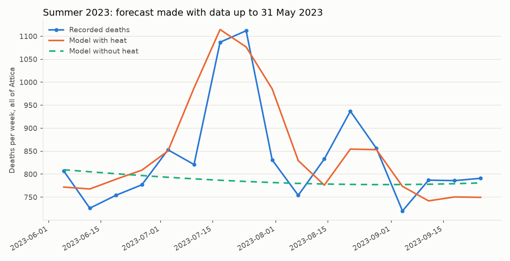
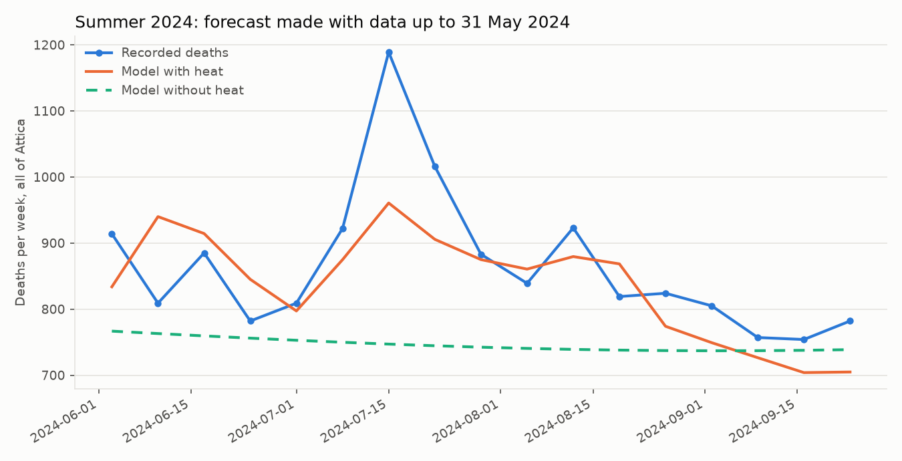

# BUARO results: Attica, step 1.1

Run date: 2026-11-13. Data up to week 2026-W27. Deaths dataset: `demo_r_mwk3_t`.

## What this step answers

How much does heat raise the number of deaths in each part of Attica, can a model that knows this forecast a summer better than a model that ignores heat, and is Attica becoming less vulnerable over time?

## Two ways to set the normal level of deaths

Heat deaths are measured against a normal level of deaths. The pipeline tests two ways to set it, and keeps the one that forecasts unseen summers better:

- **All-weeks baseline**: learns the normal level from every week of the year, with a long-term trend.
- **EuroMOMO-style baseline**: learns the normal level only from calm weeks in spring (weeks 16 to 25) and autumn (weeks 37 to 44), with a separate level for each year, as the European mortality monitoring network EuroMOMO does. A hard winter or a hot summer cannot distort it.

| Baseline | Summers tested | Mean weekly error with heat | Summers where heat improved the forecast |
|---|---|---|---|
| EuroMOMO-style baseline | 3 | 73.1 | 2 of 3 |
| All-weeks baseline | 3 | 83.4 | 2 of 3 |

Selected: **EuroMOMO-style baseline** (rule fixed in advance: lowest mean weekly error over all tested summers).

## How vulnerable each area is

The heat threshold was learned from the data: weeks hotter than the 80th percentile of each area's weekly maximum temperature.
Across Attica, each extra 1°C above that threshold raises weekly deaths by about 5.4% (95% range 4.4% to 6.4%).
Differences between areas beyond chance (I²): 83%.
Verdict: the data show a clear heat effect on mortality.

| Area | Extra deaths per +1°C | 95% range | Share aged 65+ | Threshold (°C) |
|---|---|---|---|---|
| Western Athens | 6.1% | 5.1% to 7.2% | 20.8% | 31.5 |
| Piraeus, Islands | 6.0% | 5.1% to 7.0% | 22.4% | 31.3 |
| Southern Athens | 6.0% | 5.0% to 7.1% | 23.7% | 31.5 |
| Western Attica | 5.8% | 4.4% to 7.3% | 17.8% | 31.3 |
| Eastern Attica | 5.5% | 4.5% to 6.6% | 20.5% | 31.0 |
| Northern Athens | 4.5% | 3.6% to 5.5% | 24.2% | 30.6 |
| Central Athens | 3.6% | 2.8% to 4.3% | 22.7% | 31.1 |

## Is Attica adapting?

The model lets the heat effect change linearly from year to year. A negative trend means each degree of heat is becoming less deadly.
Estimated extra deaths per +1°C: 6.5% in 2015 and 4.8% in 2025.
Yearly change in the log relative risk: -0.0016 (95% range -0.0026 to -0.0007).
Verdict: not robust. The trend points to heat becoming less deadly per degree, but it disappears when the summer of 2025 is left out. One unusual summer is not evidence of adaptation, so no claim is made yet.

A check that needs no model: how many extra summer deaths each degree of heat brought, year by year.

| Summer | Extra deaths, weeks 26 to 36 | Degree-weeks above threshold | Extra deaths per degree-week |
|---|---|---|---|
| 2015 | 523 | 19.7 | 26.6 |
| 2016 | 430 | 15.8 | 27.2 |
| 2017 | 817 | 24.1 | 33.9 |
| 2018 | 407 | 9.7 | 42.1 |
| 2019 | 113 | 15.5 | 7.3 |
| 2023 | 1,086 | 29.6 | 36.6 |
| 2024 | 1,323 | 32.5 | 40.7 |
| 2025 | 327 | 27.5 | 11.9 |

## The test: forecasting summers the model has never seen

For each summer, the model is trained only on data available up to 31 May of that year, then asked to predict June to September.
A skill score above 0 means that knowing about heat made the forecast better.

| Summer | Recorded deaths | Forecast with heat | Forecast without heat | Heat-attributable deaths | Skill score |
|---|---|---|---|---|---|
| 2023 | 14,232 | 14,481 | 13,378 | 1,724 | 0.67 |
| 2024 | 14,712 | 14,213 | 12,687 | 2,106 | 0.73 |
| 2025 | 13,229 | 13,676 | 12,912 | 1,362 | -0.46 |

Knowing about heat improved the forecast in 2 of 3 summers tested.

## Cross-check against published research

ISGlobal (Janoš et al. 2025, Nature Medicine), Greece, summer 2024: 5,980 heat-related deaths in Greece. Scaled to Attica's population share, that is about 2,176.
This model estimates 2,106 for Attica in summer 2024.
Order-of-magnitude cross-check only. ISGlobal uses daily data and a different model; weekly data are known to underestimate heat mortality by 5% to 20%.

## Data

Every weekly number used by the model is in `data_panel.xlsx`, so anyone can check the results.

## Honest limits

- Deaths are weekly and by area (NUTS 3), not daily or by neighbourhood. Step 2 brings the 1 km census grid and satellite surface temperature.
- Temperature is ERA5-Land reanalysis (about 11 km), averaged over two points per area.
- Pandemic weeks (2020-W10 to 2022-W26) are left out of training, because COVID-19 deaths would distort the heat signal.
- The adaptation test assumes a straight-line change over time and has few post-pandemic summers. It is repeated with each summer left out, and a trend is only reported as evidence if no single summer changes the verdict.
- The pooled estimates are empirical Bayes (random-effects shrinkage), a first step towards the full Bayesian layer of the framework.
